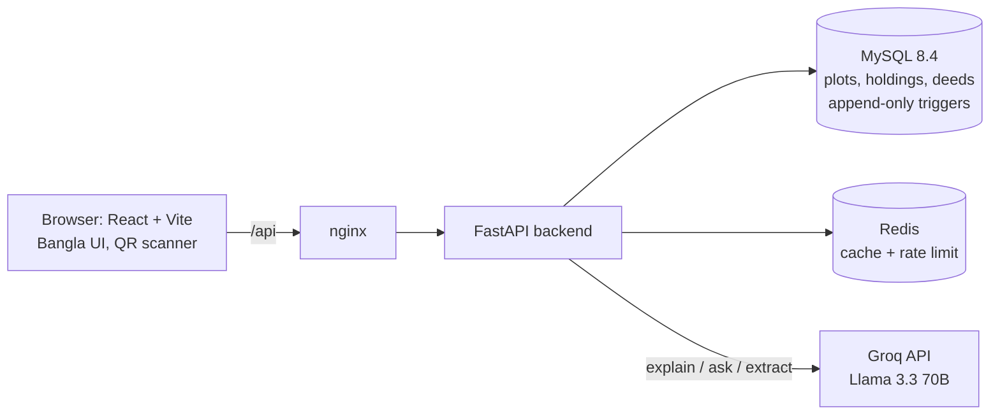

# জমি প্রমাণ · JomiProman

**A tamper-evident land-deed ledger that catches fake deeds and double-selling before money changes hands.**
Built for the **LandTech Innovation Hackathon 2026** (DIU), track *Digital Land Records, Verification & Digitization*.

> **All data in this repository is dummy data.** Every name, mouza, plot, bank and court case is fictional. No government website was scraped and no real land record was used.

| Problem chosen (rulebook §5) | How this project answers it |
|---|---|
| **P3 Catch Fraud & Double-Selling** (main) | A rules engine checks every sale: is the seller the owner, does the sold area exceed what the seller still holds, is the land mortgaged, in a court case, khas, or different from the khatian? |
| **P2 Verify Deeds & Ownership** | Every deed gets a SHA-256 fingerprint, a hash-chain link, an Ed25519 signature and a QR code. A changed paper copy turns red and the exact changed fields are shown. |
| **P5 Check Before You Buy** | A citizen page shows current owners, remaining area, transfer history, mutation status and legal flags in plain Bangla. |
| P4 Smart e-Mutation (partial) | Each registered deed starts with mutation *pending*; the land office completes it, and pending mutation is shown as a warning. |

---

## Contents
1. [Quick start (Docker)](#quick-start-docker)
2. [Admin control center](#admin-control-center)
3. [Run it from IntelliJ IDEA](#run-it-from-intellij-idea)
4. [The 90-second demo](#the-90-second-demo)
5. [How it works](#how-it-works)
6. [AI features (Groq)](#ai-features-groq)
7. [Architecture & project structure](#architecture--project-structure)
8. [API](#api)
9. [Configuration](#configuration)
10. [Tests](#tests)
11. [Security notes](#security-notes)
12. [Limitations & roadmap](#limitations--roadmap)
13. [Team, mentors & AI-tool disclosure](#team-mentors--ai-tool-disclosure)

---

## Quick start (Docker)

You need Docker with Docker Compose. This project supports Linux and Windows 10/11 through Docker.

- **Windows:** read [`WINDOWS-QUICKSTART.md`](WINDOWS-QUICKSTART.md), then double-click `SETUP-Windows.bat`. Everyday start/stop/status shortcuts are included.
- **Linux:** run `chmod +x setup-linux.sh` and `./setup-linux.sh`.

The Windows and Linux setup scripts create `.env` from `.env.example` if needed, validate the Compose config, build/start the stack, then wait for the web and API health endpoints.

| What | Where |
|---|---|
| Web app | http://localhost:3100 |
| API docs (Swagger) | http://localhost:8101/api/docs |
| Health check | http://localhost:8101/api/health |
| MySQL (host tools, localhost only) | `127.0.0.1:13306` |
| Redis (host tools, localhost only) | `127.0.0.1:16379` |

The first start creates the tables, installs the ledger triggers and loads dummy demo data. Containers: **MySQL 8.4**, **Redis 7**, **FastAPI backend**, **React app served by nginx** (which also proxies `/api` to the backend).

This package uses a separate Compose project (`jomiproman-new`) and fresh named volumes, so it will not reuse the older project database. Defaults avoid the common host-port collisions: web `3100`, API `8101`, MySQL host access `13306`, Redis host access `16379`. MySQL/Redis host ports bind to `127.0.0.1` only. The backend uses the internal Compose addresses `mysql:3306` and `redis:6379`.

Stop: `docker compose down` (data is kept in Docker volumes). Wipe everything: `docker compose down -v`.
Reset only the demo data: `make reset-demo`.

**বাংলায় সংক্ষেপে:** `./setup-linux.sh` চালান। এটি `.env` না থাকলে তৈরি করবে, Docker Compose config যাচাই করবে, app build/start করবে, তারপর health check করবে। অ্যাপ `http://localhost:3100` এ খুলবে। Groq key না দিলেও app-এর বাকি অংশ চলে (AI অংশ fallback explanation দেখাবে)।

---


## Admin control center

Open `http://localhost:3100/admin` and enter the separate `ADMIN_KEY` stored in the root `.env` file. The Windows and Linux setup scripts generate a random local admin key if `.env` has the placeholder value. The browser keeps it in this tab's session storage only. The admin key is distinct from `REGISTRAR_KEY`.

The admin console is read-only for legal deed data and includes:
- Operational metrics: plots, deed totals, blocked/risk counts, pending/completed mutation and activity counts.
- Service configuration view: database/cache state, AI mode/model, signing algorithm/key id and demo-seed mode.
- Searchable activity audit log with action/outcome filters, paging and CSV export.
- Searchable deed ledger with status/risk/mutation filters, plus a searchable plot inventory and record flags.
- Quick links to all existing verification, registration and flagged-deed workflows.

Important actions are logged to the new `audit_events` table: plot checks, deed registration attempts (including blocked attempts), QR/paper-copy verification, mutation completion, location updates, AI feature use, demo-seed operations, failed registrar/admin-key attempts, admin overview access and audit CSV export. Logs store action summaries, outcomes and limited metadata; they deliberately do not store raw AI prompts, deed text or submitted access keys. The audit log is an operational monitoring feature, not an independent legal proof of ownership. As with all prototype data, seeded records are fictional.

For deployment outside a local demo, rotate both `ADMIN_KEY` and `REGISTRAR_KEY`, use HTTPS, add actual user/role authentication and review the privacy/security posture before importing personal or legal records.

---

## Run it from IntelliJ IDEA

Open the folder `jomi-proman` (the one containing `docker-compose.yml`) with **File → Open**. The commands below use API port `8101` and frontend port `5173`.

> IntelliJ IDEA **Ultimate** has Python, Docker and Database tools built in. On **Community**, install the *Python Community Edition* plugin; run Docker from the terminal tab.

**1. Start the database and cache (terminal tab, or the Docker gutter icon on `docker-compose.yml`):**
```bash
cp .env.example .env
docker compose up -d mysql redis
```

**2. Backend (Python 3.12+; developed on 3.13):**
- *File → Project Structure → SDKs → +* → **Add Python SDK → Virtualenv**, location `backend/.venv`.
- In the terminal: `cd backend && pip install -r requirements-dev.txt`
- *Run → Edit Configurations → + → Python*:
  - Run: **module** `uvicorn`
  - Parameters: `app.main:app --reload --port 8101`
  - Working directory: `…/jomi-proman/backend`
- The backend reads `../.env` itself, so `DATABASE_URL` and `REDIS_URL` from `.env.example` already point to the containers on localhost.

**3. Frontend:**
```bash
cd frontend && npm install && npm run dev      # http://localhost:5173
```
Vite proxies `/api` to `http://localhost:8101` (change with `VITE_API_PROXY`).

**4. (Ultimate) Database tool:** *Database → + → MySQL*, host `localhost`, port `13306`, user `jomi`, password `jomi_pass`, database `jomiproman`.

Quick check without MySQL: `cd backend && python -m pytest` runs the whole test suite on SQLite.

---

## The 90-second demo

Full narrated script: [`docs/DEMO_SCRIPT.md`](docs/DEMO_SCRIPT.md). The story, with dummy data (Mouza *রহিমপুর*, dag *৪১২*, 10 shatangsha, owner *করিম*):

1. **Register deed A**: করিম sells **6** shatangsha to রফিক → ✅ green, hash-chained, signed, QR code issued. 4 remain.
2. **Register deed B**: করিম tries to sell **7** more to সালমা → 🔴 blocked: *possible double-sale, only 4 left.* Land does not move; the attempt is kept for audit.
3. **Tamper test** (*Verify → paper copy*): load the correct values, change the buyer's name, verify → 🔴 *document altered*, with a table of exactly which field changed.
4. **Check before you buy** (`রহিমপুর / ৪১২`): owners করিম 4 + রফিক 6, history with the blocked deed, plain-Bangla AI explanation, and a Q&A box.
5. **Other flags to show** (seeded plots): `রহিমপুর/৪১৩` bank lien, `চন্দনপুর/১০১` court case, `শ্যামপুর/৫৫` khas land, `চন্দনপুর/১০২` khatian spelling mismatch (amber).

Registering needs the demo registrar key `demo-registrar` (pre-filled in the form).

---

## How it works

### Deed → fingerprint → chain → signature
```
fingerprint = SHA-256( canonical JSON of deed_no, mouza, dag, seller, buyer, area, deed_date )
record_hash = SHA-256( previous_record_hash | fingerprint )      # first link starts from SHA-256("GENESIS|mouza|dag")
signature   = Ed25519( record_hash )                              # sub-registrar key, public key at /api/public-key
```
- Change **any** field on a paper copy → the recomputed fingerprint differs → **DOC_ALTERED**, listing the changed fields.
- Edit a row in the database → fingerprint/hash no longer match → **RECORD_TAMPERED**. Rewrite history → **CHAIN_BROKEN**. Forge a signature → **SIGNATURE_INVALID**.
- The chain is re-verified whenever a plot view is built, on every verification, and on demand (`/api/plots/{mouza}/{dag}/chain`), not only at write time.
- No blockchain is needed: it is an append-only, hash-chained, signed ledger.

### Database-level protection (MySQL triggers)
Once a deed is signed, MySQL itself refuses `UPDATE` of its legal columns and `DELETE`, even for raw SQL (only the `mutation_status` workflow column may change). Try it:
```bash
docker compose exec mysql mysql -ujomi -pjomi_pass jomiproman \
  -e "UPDATE deeds SET buyer='X' WHERE deed_no='D-0001'"
# ERROR 1644 (45000): Ledger is append-only: signed deed records cannot be changed or deleted
```
A DBA could drop the triggers, which is why the hash chain and signatures are checked independently on every read.

### Fraud rules (`backend/app/services/rules.py`)
| Severity | Code | Meaning |
|---|---|---|
| 🔴 Red (deed is **blocked**) | `NOT_OWNER` | Seller does not hold any of this plot |
| | `AREA_EXCEEDS` | Seller sells more than they still hold, i.e. possible **double-sale** |
| | `PLOT_BANK_LIEN` | Land is mortgaged to a bank |
| | `PLOT_COURT_CASE` | Land is under a court case |
| | `PLOT_KHAS` | Government khas land |
| | `KHATIAN_MISMATCH` | Seller's name is different from the khatian name |
| | `SELF_SALE` | Seller and buyer are the same person |
| 🟡 Amber (registered, with warning) | `NAME_MISMATCH` | Seller's name is a near-match of the owner's name |
| | `MUTATION_PENDING` | Seller's own mutation is not finished |
| | `KHATIAN_NAME_VARIANT` | Khatian spells the name slightly differently |

Names are compared with Bangla-aware fuzzy matching (`আব্দুল` ≈ `আবদুল`, `মোঃ` ignored, ী/ি and শ/ষ/স folded). Land is tracked per holder, so after করিম sells 6 and রফিক holds 6, রফিক can resell up to 6.

### Concurrency
Registration locks the plot row (`SELECT … FOR UPDATE`) so two simultaneous sales of the same plot cannot both pass the area check.

### Redis
Used for speed and shared limits, never for correctness: plot-view cache (60 s, cleared on every write), AI answer cache (1 h), per-IP rate limits (30 requests/min on verify and AI endpoints). If Redis is down the app falls back to an in-memory cache automatically.

---

## AI features (Groq)

The AI **never decides** a verdict. Green / amber / red come from deterministic rules and cryptographic checks. AI is used where language is the hard part:

| Feature | Where | What it does |
|---|---|---|
| **Plain-Bangla explanation** | every result page | Rewrites the rule findings in 3 short sentences plus one action line. |
| **Ask about this plot** | *Check before you buy* | Chat that answers **only** from that plot's ledger data (owners, history, flags); says "not in the system" otherwise. |
| **Deed text → form** | *Register* | Paste messy deed text (Bangla or English digits); AI suggests mouza/dag/seller/buyer/area/date. A human reviews, and the fraud rules still run on submit. |

Safeguards: untrusted text is wrapped in tags and the model is told to ignore instructions inside it; output is validated; answers are cached; endpoints are rate-limited; **if there is no key or Groq is unreachable, every feature falls back to a deterministic template / regex**, so the demo never breaks. The UI shows whether an answer came from `AI · <model>` or from the automatic fallback.

Setup: put your key in `.env` (`GROQ_API_KEY=…`) and restart the backend. The model is `GROQ_MODEL` (default `openai/gpt-oss-120b`). Only dummy data is ever sent to Groq.

---

## Architecture & project structure



```
jomi-proman/
├── docker-compose.yml        MySQL + Redis + backend + frontend
├── .env.example              all settings, documented
├── Makefile                  make up | db | test | reset-demo ...
├── backend/
│   ├── Dockerfile
│   ├── requirements*.txt
│   ├── app/
│   │   ├── main.py           app, CORS, error handlers, start-up
│   │   ├── config.py         environment settings
│   │   ├── database.py       SQLAlchemy engine, create tables
│   │   ├── db_guards.py      append-only triggers (MySQL + SQLite)
│   │   ├── models.py         Plot, Holding, Deed
│   │   ├── schemas.py        request / response models
│   │   ├── security.py       fingerprint, hash chain, Ed25519
│   │   ├── seed.py           dummy demo data
│   │   ├── routers/          deeds, verify, plots, assistant (AI), system
│   │   └── services/         rules, ledger, verification, names, ai, cache, qr
│   └── tests/                61 tests
├── frontend/
│   ├── Dockerfile, nginx.conf
│   └── src/ pages/ components/ api.js
├── docs/                     ARCHITECTURE.md, DEMO_SCRIPT.md
└── .github/workflows/ci.yml  tests + build on every push
```
More detail: [`docs/ARCHITECTURE.md`](docs/ARCHITECTURE.md).

---

## API

Interactive docs: `/api/docs`. 🔑 = needs header `X-Registrar-Key`.

| Method & path | Purpose |
|---|---|
| `POST /api/deeds` 🔑 | Run fraud rules, then register (or block) a deed |
| `POST /api/deeds/{deed_no}/mutation` 🔑 | Complete e-Mutation for a registered deed |
| `GET /api/deeds`, `/api/deeds/flagged`, `/api/deeds/{deed_no}` | Recent, suspicious, single deed |
| `GET /api/deeds/{deed_no}/qr` | QR code (PNG) linking to the verification page |
| `POST /api/verify` | Compare a paper copy's fields with the ledger |
| `GET /api/verify/{deed_no}?hash=…` | Verify from a QR code |
| `GET /api/plots`, `/api/plots/{mouza}/{dag}` | Plot list; full "check before you buy" view |
| `GET /api/plots/{mouza}/{dag}/chain` | Re-verify the whole chain now |
| `POST /api/assistant/explain`, `/ask`, `/extract` | Groq-powered helpers (with fallbacks) |
| `GET /api/health`, `/api/stats`, `/api/public-key` | Status, numbers, signing public key |
| `POST /api/seed?reset=true` 🔑 | Reload dummy data (disabled in production) |

Errors have one shape: `{"error": {"code": "...", "message": "<Bangla message>"}}`.

---

## Configuration

All settings are environment variables (see `.env.example`).

| Variable | Default | Notes |
|---|---|---|
| `GROQ_API_KEY` | empty | empty = fallback mode |
| `GROQ_MODEL` | `openai/gpt-oss-120b` | any Groq chat model id |
| `REGISTRAR_KEY` | `demo-registrar` | with `ENVIRONMENT=production` the default is refused at start-up |
| `PUBLIC_BASE_URL` | `http://localhost:3100` | written into QR codes; set to your live URL when deployed |
| `DATABASE_URL` / `REDIS_URL` | set by compose | local-run values are in `.env.example` |
| `SIGNING_KEY_B64` / `SIGNING_KEY_PATH` | key file in a volume | Ed25519 seed; generated on first start and persisted |
| `AUTO_SEED` | `true` | load dummy data when the database is empty |

---

## Tests

```bash
cd backend && pip install -r requirements-dev.txt && python -m pytest     # backend automated tests; no Docker needed
```
They cover the demo story end to end through the HTTP API, every fraud rule, Bangla name matching, tamper detection (edited row, forged signature, rewritten history), the append-only triggers, rate limiting, and the AI layer with a mocked Groq (success, failure and prompt-injection cases) plus the no-key fallback. Tests use SQLite; the same triggers are generated for MySQL. GitHub Actions runs the tests and the frontend build on every push.

---

## Security notes
- Write endpoints require the sub-registrar key (constant-time compare); the default demo key is refused in production mode.
- Ed25519 private key lives in a Docker volume (or `SIGNING_KEY_B64`), never in the repo; `.env` and `*.key` are git-ignored.
- Verification responses name *which fields* changed on a paper copy but never expose other people's data beyond what a buyer needs.
- Inputs are validated (Pydantic); SQL goes through SQLAlchemy; AI input is length-limited, fenced and rate-limited.

## Limitations & roadmap
- Prototype scope: one simulated sub-registrar key and a shared registrar key, not a full role/login system (planned: per-office accounts and keys, audit log, two-person approval).
- Data entry is manual or AI-assisted from text. **Bangla OCR of scanned khatians (P1)** is on the roadmap; it is deliberately not in the MVP because wrong OCR output is dangerous for legal records.
- Names are matched within Bangla script only (no Karim ↔ করিম transliteration yet).
- Next: integration with real mutation workflows (AC Land), bank lien API, court-case feed, SMS alerts to owners when a deed is registered on their plot, Alembic migrations.
- Nationwide rollout idea: each sub-registry runs a node and signs with its own key; verification only needs public keys, so offices do not need to share databases.

## Team, mentors & AI-tool disclosure
- **Team:** _<team name>_ · Students: _<name, DIU ID>_, _<name, DIU ID>_ · Faculty mentor: _<name>_ · Industry mentor: _<name>_  *(fill in before submission)*
- **AI tools used (rulebook requirement):** Claude (Anthropic) assisted with planning, code generation and documentation of this project; the team reviewed and can explain the code. **Groq (Llama 3.3 70B)** is used at runtime for the three AI features above.
- Licenses of dependencies are their own (FastAPI, SQLAlchemy, React, Vite, html5-qrcode, rapidfuzz, cryptography, qrcode, redis-py, httpx).


## New: language, theme and map location

- **EN / বাং switch** and **Light / Dark switch** are in the top bar (choice is remembered in the browser). UI text lives in `frontend/src/strings.js`.
  Verdict messages that come from the backend rules and the AI assistant stay in Bangla.
- **Google Maps location**: each plot can have latitude/longitude. Buyers see it on the *Check before buying* page and can open Maps / get directions.
  A registrar can add or change it (paste a Maps link, type lat/lng, or use "my current location"), also right after registering a deed.
  API: `PUT /api/plots/{mouza}/{dag}/location` (needs `X-Registrar-Key`). Existing databases get the new columns automatically on start-up.
  The map uses the keyless Google Maps embed, so no API key is needed.
- Tests: `cd backend && pytest` and `cd frontend && npm test`.
