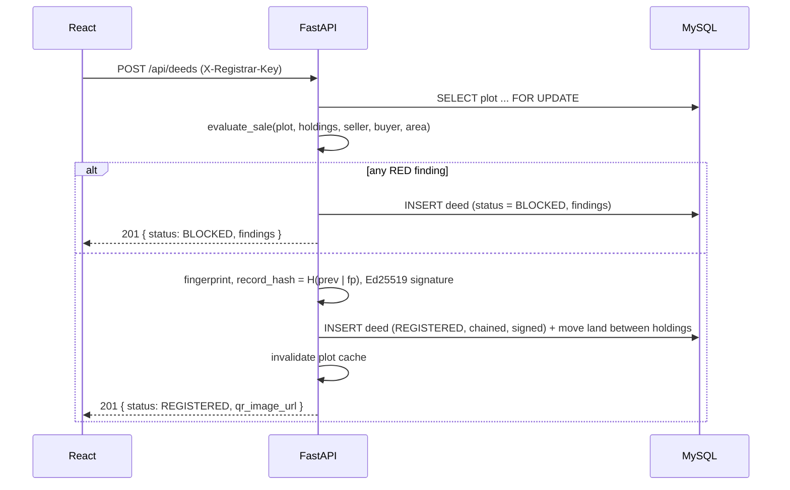

# Architecture

## Components

| Part | Technology | Responsibility |
|---|---|---|
| Web app | React 18, Vite, React Router, html5-qrcode | Bangla UI, QR scanning, forms, result pages |
| Reverse proxy | nginx | Serves the built app, proxies `/api` to the backend |
| API | FastAPI, Pydantic, SQLAlchemy 2 | Rules, ledger, verification, AI helpers |
| Database | MySQL 8.4 (SQLite for tests) | Plots, holdings, deeds; append-only triggers |
| Cache | Redis 7 (in-memory fallback) | Plot-view cache, AI cache, rate limits |
| AI | Groq API (Llama 3.3 70B) | Explain, answer plot questions, extract deed fields |

## Data model

```
plots     id, mouza, dag, khatian_no, land_type, total_area,
          has_bank_lien, lien_bank, has_court_case, case_ref, is_khas        UNIQUE(mouza, dag)
holdings  id, plot_id, holder_name, holder_norm, area, khatian_name          (khatian_name NULL = mutation pending)
deeds     id, deed_no, plot_id, seller, buyer, area, deed_date,
          status (REGISTERED | BLOCKED), risk (GREEN|AMBER|RED), findings (JSON), mutation_status,
          fingerprint, prev_hash, record_hash, chain_index, signature
```
`holdings` is the current state (who owns how much); `deeds` is the history. Blocked deeds are stored for audit but are not part of the chain and move no land.

## Registering a deed



## Verifying

- **QR scan** (`GET /api/verify/{deed_no}?hash=…`): the QR carries the deed number and fingerprint. The server checks that the deed exists, is not blocked, that the fingerprint matches, and that the plot's chain and signatures are valid.
- **Paper copy** (`POST /api/verify`): the server recomputes the fingerprint from the typed fields and compares it to the ledger; if it differs, each field is compared to report exactly what changed.
- Result is **green** (all checks pass), **amber** (valid but with warnings such as pending mutation) or **red** (altered, tampered, blocked or not found).

## Integrity layers

1. Fraud rules stop bad deeds entering the ledger.
2. Fingerprint + hash chain + Ed25519 signature make every stored deed self-verifying.
3. MySQL triggers refuse changes to signed rows (defence in depth).
4. Every read re-verifies the chain, so even a DBA who removes the triggers is detected.

## Failure behaviour
- Redis down → in-memory cache, same behaviour, per-process limits.
- Groq key missing / timeout / bad output → deterministic template or regex fallback; the UI labels the source.
- Database starting up → backend retries for about a minute; compose also waits for the health check.
